# 1. Identité visuelle

Vite & Gourmand est un traiteur bordelais, et sa baseline est « Traiteur de la mer ». L'interface reprend cet univers : **bleu pétrole et bleu encre** pour l'océan, **corail** pour la touche chaleureuse et gourmande, **sauge, sable et écume** pour des fonds clairs et doux. L'ensemble doit inspirer confiance (des couleurs sobres, des titres élégants) tout en restant simple à utiliser pour des clients de tout âge.

Principes retenus :

- **Lisibilité d'abord** : texte foncé sur fond clair, contraste d'au moins 4,5:1 pour tout le texte (RGAA).
- **Une couleur d'action** : le corail signale ce sur quoi on peut cliquer (boutons principaux, onglet actif).
- **Formes douces** : boutons en pilule (coins arrondis à 20 px), cartes à coins arrondis, pied de page aux angles supérieurs arrondis.
- **Responsive** : la même charte s'applique sur ordinateur et sur mobile. Le menu se replie derrière un bouton sur petit écran.

# 2. Palette de couleurs

## Couleurs principales

  

Encre

#0F2E38

Texte principal, texte des boutons corail, fond au survol des boutons

  

Pétrole

#1B4B5A

Pied de page, en-têtes de cartes et de formulaires, liens, bandeaux

  

Corail

#E8865A

Boutons d'action, bandeau « Nos menus », « & » du logo, étoiles des avis

  

Sauge

#7FA69C

Fond des cartes de menus, badge « Client » de la liste des comptes

  

Sable

#F2E8D5

Fond général des pages, fond des commandes dans l'espace client

  

Écume

#FAF6EE

Barre de navigation, formulaires, cartes, avis

## Nuances ajoutées pour l'accessibilité

Le corail est trop clair pour servir de couleur de **texte** sur fond clair (contraste 2,2:1), et un peu trop foncé sur fond pétrole (3,6:1). Deux nuances sont réservées au texte :

  

Corail texte

#A84A22

Texte corail sur fond clair (onglet actif) : contraste 5,3:1 sur Écume

  

Corail clair

#F4A988

Titres sur fond Pétrole (formulaires, cartes, pied de page) : 4,9:1

  

Vert succès

#1E7E34

Statuts « Accepté » et « Publié » (texte blanc : 5,1:1)

  

Rouge danger

#B02A37

Annuler, supprimer, messages d'erreur : 6,0:1 sur Écume

## Associations validées

| Texte | Fond | Contraste | Exemple |
|---|---|---|---|
| Encre | Sable | 11,8:1 | Texte des pages |
| Écume | Pétrole | 8,9:1 | Texte du pied de page |
| Encre | Corail | 5,4:1 | Boutons « Connexion », « Commander » |
| Encre | Sauge | 5,3:1 | Titre et description des cartes de menus |
| Corail clair | Pétrole | 4,9:1 | Titres « Connexion », « Mes commandes » |

Les couleurs sont déclarées une seule fois, comme variables CSS en tête de `Front-end/style.css` (`--Encre`, `--Petrol`, `--Corail`…).

# 3. Typographie

Les trois polices viennent de Google Fonts, sous licence libre SIL Open Font License.

  
Fraunces

  
Vite &amp; Gourmand — Menu de Noël — Commander

  
Police à empattements, élégante et chaleureuse. <b>Usage</b> : logo, titres (h1, h2), navigation, boutons, titres des formulaires. Graisses 500 à 600.

  
Work Sans

  
Depuis 25 ans, Julie et José régalent les Bordelais avec une cuisine de traiteur généreuse.

  
Police sans empattements, très lisible à petite taille. <b>Usage</b> : tout le texte courant, les formulaires, le pied de page. Graisses 400 (texte) et 600 (mise en avant).

  
IBM Plex Mono

  
45,00 € / pers. — 8 personnes minimum

  
Police à chasse fixe : les chiffres sont alignés. <b>Usage</b> : prix, montants, dates de suivi, informations de l'entreprise.

| Élément | Police | Taille |
|---|---|---|
| Titre principal (h1) | Fraunces 500 | 40 à 48 px |
| Titre de section (h2) | Fraunces 500 | 20 à 32 px |
| Navigation | Fraunces 600 italique | 18 px |
| Texte courant | Work Sans 400 | 16 px |
| Petits textes, badges | Work Sans 400 à 600 | 12 à 14 px |
| Prix | Police à chasse fixe 600 | 15 px |

# 4. Éléments d'interface

- **Boutons d'action** : fond Corail, texte Encre, forme pilule (`border-radius: 20px`). Au survol, le fond passe en Encre et le texte en Corail.
- **Boutons secondaires et dangereux** : contour seul. Contour rouge pour « Annuler la commande », « Supprimer mon compte » ou « Refuser ».
- **Cartes de menu** : photo en haut, corps Sauge (titre en capitales, description, régimes, rappel des conditions), pied avec le nombre minimum de personnes, le prix et les boutons « Détails » et « Commander ».
- **Cartes de l'espace client et du tableau de bord** : en-tête Pétrole avec titre Corail clair, corps Écume.
- **Badges de statut** : Corail pour « En attente », vert pour « Accepté » et « Publié », rouge pour « Annulée » et « Refusé », Pétrole pour « Terminée ».
- **Icônes** : Bootstrap Icons (œil pour afficher le mot de passe, personnes, avertissement pour les conditions, corbeille…).
- **Conditions d'un menu** : encadré jaune pâle avec icône d'avertissement, placé avant le bouton de validation, comme le demande le sujet.

# 5. Wireframes

Les wireframes fixent la structure de chaque page, sans couleurs ni images : position de la navigation, des filtres, des cartes, des formulaires et du pied de page. Les trois pages choisies sont l'**accueil**, la **liste des menus** (page centrale de l'application) et l'**espace client**.

## Wireframes bureau

<figure class="grand">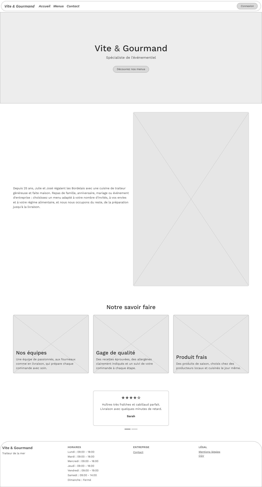<figcaption>Accueil (bureau) : bandeau, présentation, savoir-faire, avis, pied de page avec horaires.</figcaption></figure>

<figure class="grand">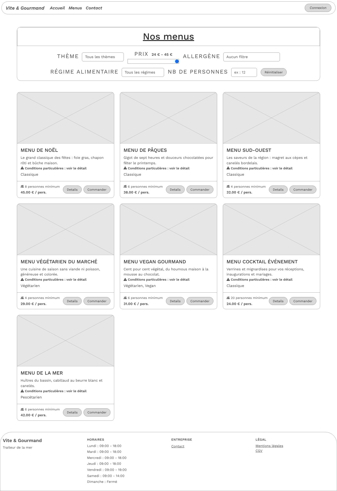<figcaption>Nos menus (bureau) : filtres en haut, grille de cartes de menus sur 3 colonnes.</figcaption></figure>

<figure class="grand">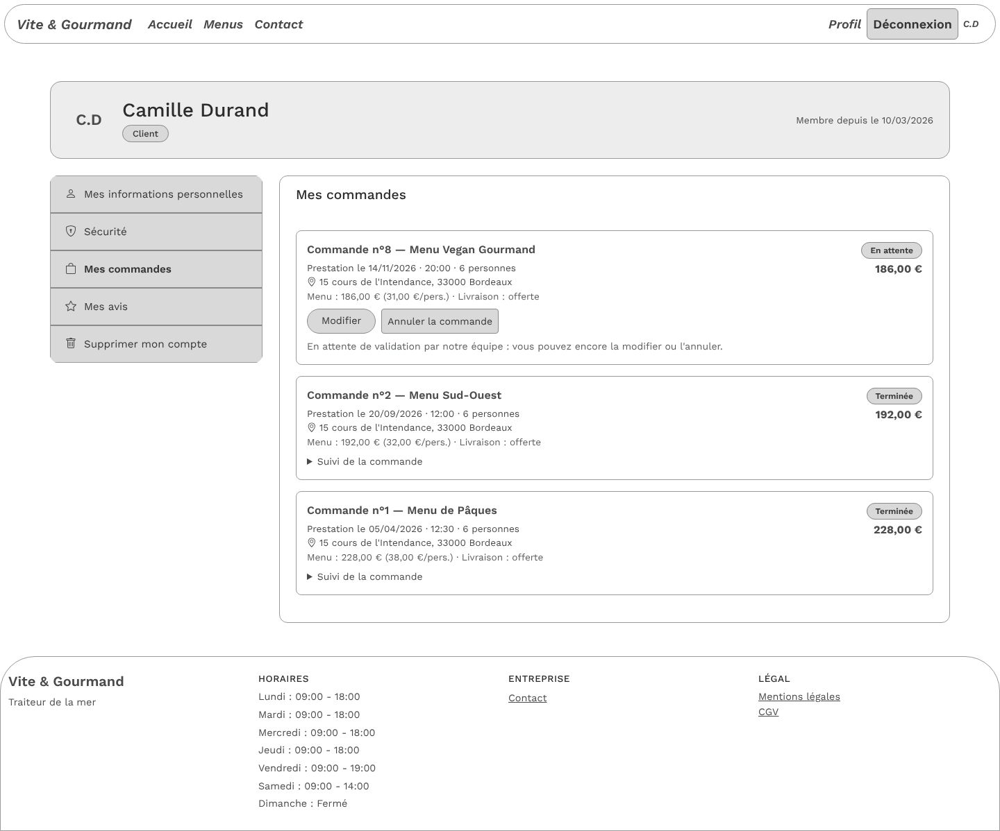<figcaption>Espace client (bureau) : en-tête du profil, menu des rubriques à gauche, commandes à droite.</figcaption></figure>

## Wireframes mobile

<figure>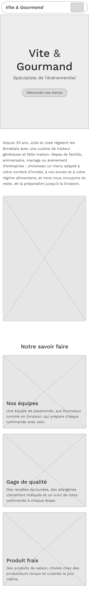<figcaption>Accueil</figcaption></figure>
<figure>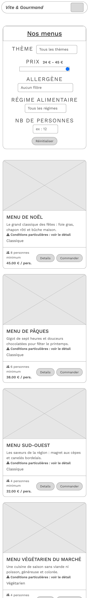<figcaption>Nos menus</figcaption></figure>
<figure>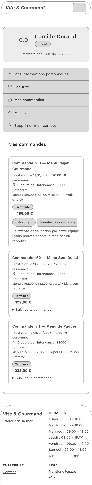<figcaption>Espace client</figcaption></figure>

Sur mobile, le menu se replie derrière un bouton. Les filtres, les cartes et les rubriques s'empilent sur une seule colonne.

# 6. Maquettes (mockups)

Les maquettes appliquent la charte (couleurs, polices, photos) aux mêmes pages.

## Maquettes bureau

<figure class="grand">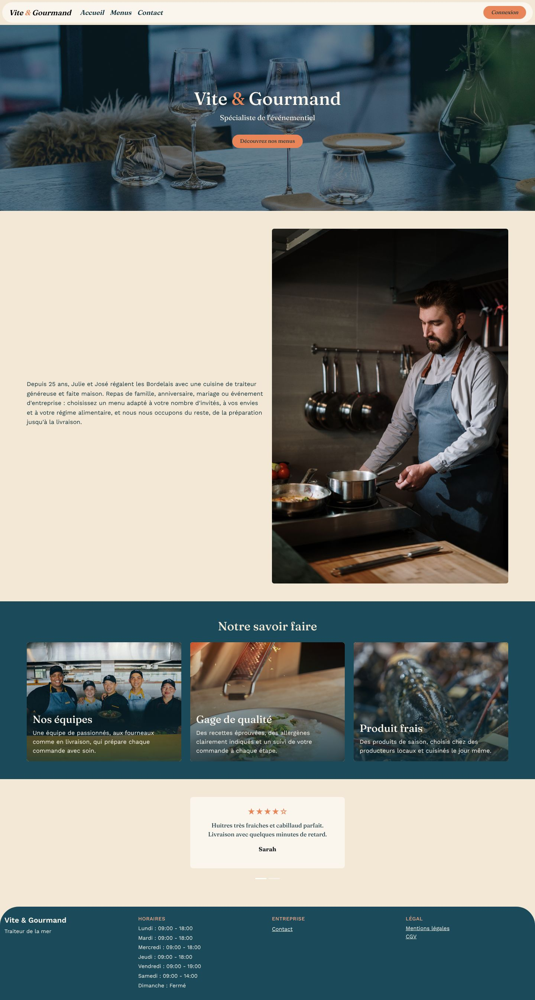<figcaption>Accueil (bureau).</figcaption></figure>

<figure class="grand">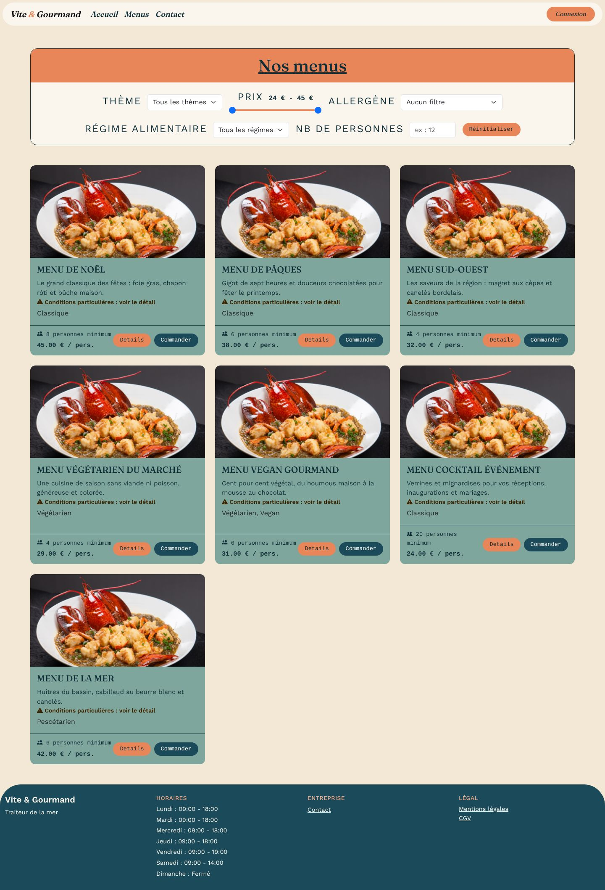<figcaption>Nos menus (bureau).</figcaption></figure>

<figure class="grand">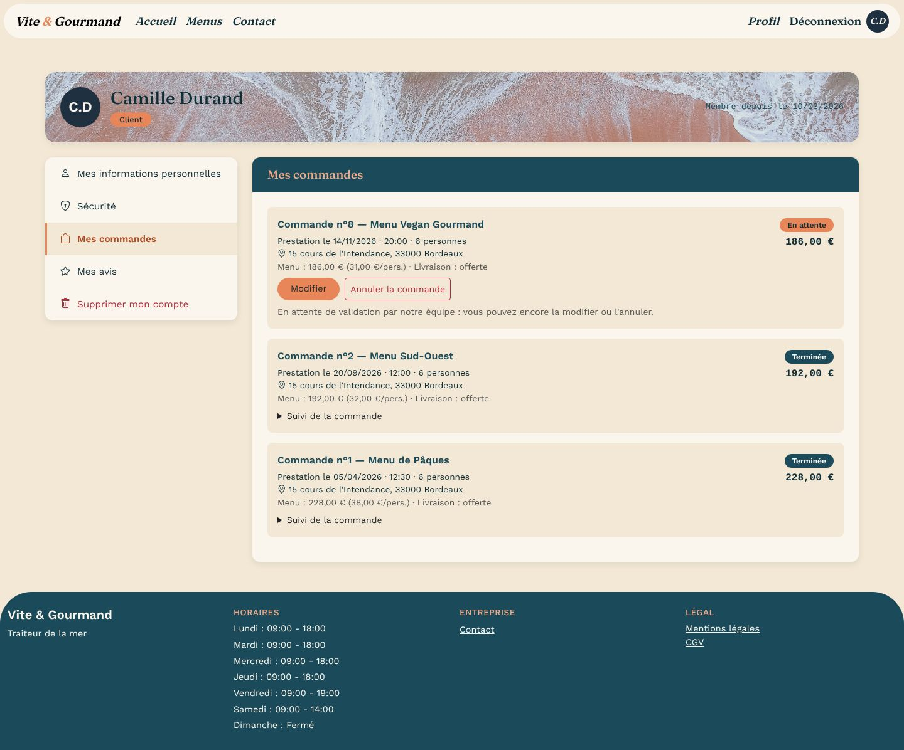<figcaption>Espace client, rubrique « Mes commandes » (bureau).</figcaption></figure>

## Maquettes mobile

<figure>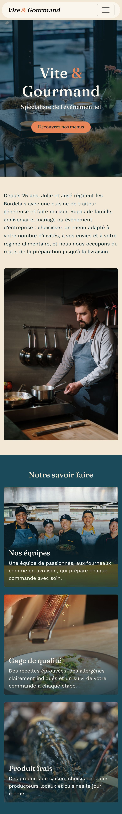<figcaption>Accueil</figcaption></figure>
<figure>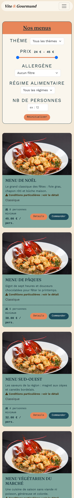<figcaption>Nos menus</figcaption></figure>
<figure>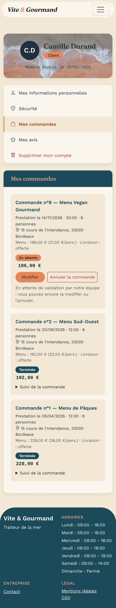<figcaption>Espace client</figcaption></figure>

