# 1. Présentation

**Vite & Gourmand** est l'application web du traiteur bordelais de Julie et José. Elle permet de :

- découvrir l'entreprise, ses menus et les avis de ses clients ;
- commander un menu en ligne, avec un prix et des frais de livraison calculés immédiatement ;
- suivre sa commande étape par étape et donner son avis une fois la prestation terminée ;
- pour l'équipe : gérer les menus, les plats, les horaires, les commandes et les avis ;
- pour l'administrateur : gérer les comptes des employés et suivre les statistiques.

## Accès

| | Adresse |
|---|---|
| Site | https://vite-gourmand-kappa.vercel.app |
| API (à ouvrir une minute avant une démonstration pour la réveiller) | https://v-g.onrender.com/api/menu |

L'application fonctionne sur ordinateur, tablette et téléphone, dans tout navigateur récent.

> L'API est hébergée sur une offre gratuite qui se met en veille après 15 minutes sans visite. La première page peut donc mettre environ une minute à afficher les menus. Ensuite, tout est immédiat.

# 2. Identifiants de test

## Sur le site en ligne

| Profil | Email | Mot de passe |
|---|---|---|
| Administrateur | <mark>à compléter</mark> | <mark>à compléter</mark> |
| Employé | <mark>à compléter</mark> | <mark>à compléter</mark> |
| Client | <mark>à compléter</mark> | <mark>à compléter</mark> |

Vous pouvez aussi créer votre propre compte client depuis « Connexion » puis « S'inscrire ». Un mail de confirmation est envoyé, et il faut cliquer sur son lien avant de pouvoir se connecter.

## En installation locale

Le fichier `database/02_donnees_demo.sql` crée ces comptes, avec des menus, des commandes à tous les statuts et des avis (voir le `README.md` pour l'installation) :

| Profil | Email | Mot de passe |
|---|---|---|
| Administrateur (José) | `admin@vite-gourmand.test` | `Admin-Demo2026!` |
| Employée (Julie) | `employe@vite-gourmand.test` | `Employe-Demo2026!` |
| Employé désactivé (pour vérifier le refus de connexion) | `ancien.employe@vite-gourmand.test` | `Inactif-Demo2026!` |
| Cliente (Camille) | `client@vite-gourmand.test` | `Client-Demo2026!` |

Les captures d'écran de ce manuel ont été réalisées avec ces données de démonstration.

# 3. Parcours du visiteur

## Page d'accueil

L'accueil présente l'entreprise et le savoir-faire de l'équipe, puis les **avis clients validés**. Le menu en haut de page mène à l'accueil, aux menus, au contact et à la connexion. Le pied de page affiche les **horaires du lundi au dimanche**, ainsi que les liens vers les mentions légales et les conditions générales de vente.

<figure>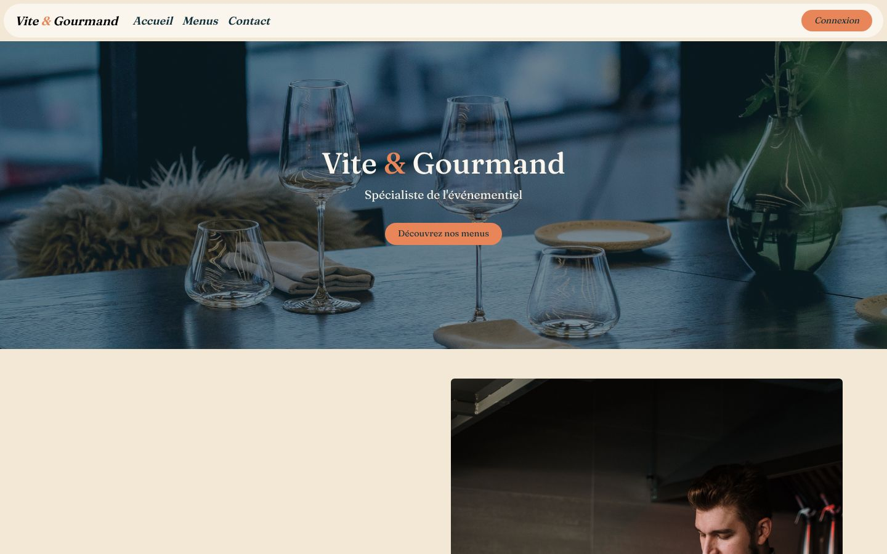<figcaption>Page d'accueil.</figcaption></figure>

<figure>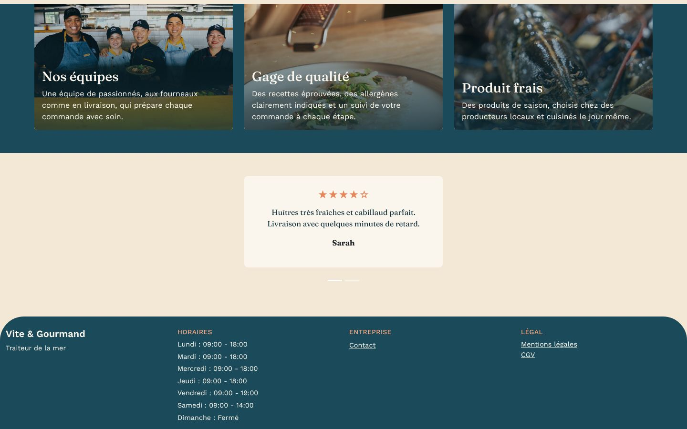<figcaption>Savoir-faire, avis validés et pied de page avec les horaires.</figcaption></figure>

## Consulter et filtrer les menus

La page **Menus** présente tous les menus : titre, description, régime, nombre minimum de personnes et prix par personne.

Les **filtres** mettent la liste à jour immédiatement, sans recharger la page :

- **Thème** (Noël, Pâques, Classique, Événement) ;
- **Prix** : un curseur pour le prix maximum, un second pour le minimum, ce qui donne une fourchette ;
- **Allergène** : n'affiche que les menus sans l'allergène choisi ;
- **Régime alimentaire** (Classique, Végétarien, Vegan…) ;
- **Nombre de personnes** : n'affiche que les menus dont le minimum est inférieur ou égal au nombre saisi.

« Réinitialiser » efface tous les filtres.

<figure>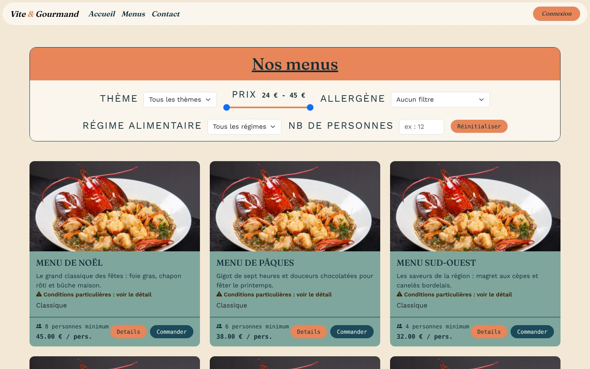<figcaption>Liste des menus et filtres.</figcaption></figure>

<figure>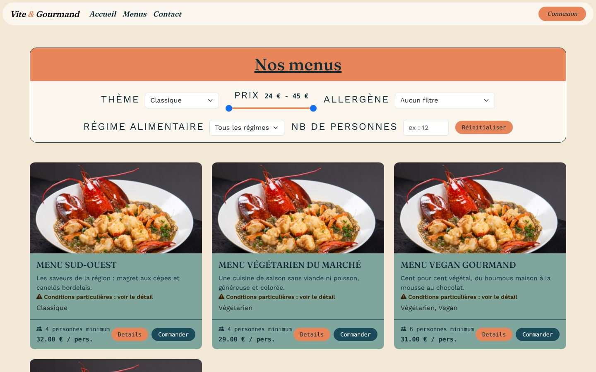<figcaption>Filtre par thème « Classique » : la liste se met à jour instantanément.</figcaption></figure>

## Voir le détail d'un menu

Le bouton **Détails** ouvre la fiche complète du menu :

- les **conditions du menu**, en évidence en haut (délai de commande, conservation, matériel prêté…) ;
- la description, le nombre minimum de personnes, le prix et le stock restant ;
- les régimes, les thèmes, les **allergènes** et la liste des plats.

Le bouton **Commander** est disponible en bas de la fiche. Un visiteur non connecté est invité à se connecter ou à créer un compte.

<figure>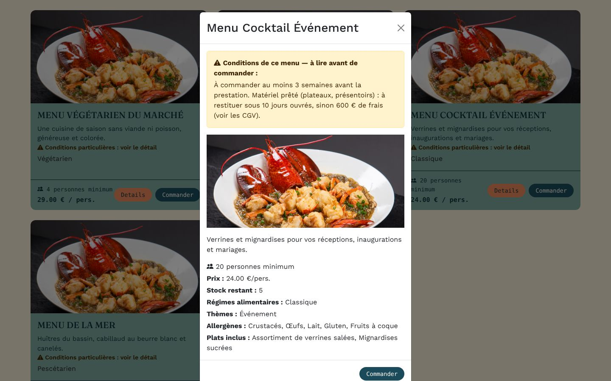<figcaption>Fiche détaillée d'un menu, avec ses conditions en évidence.</figcaption></figure>

## Créer un compte

Depuis **Connexion**, puis **S'inscrire**, le formulaire demande :

- le nom et le prénom ;
- l'email et le numéro de GSM (06 ou 07) ;
- l'adresse postale, avec un code postal à 5 chiffres ;
- un mot de passe sécurisé : **10 caractères minimum, avec une majuscule, une minuscule, un chiffre et un caractère spécial**. Une jauge et une liste de règles indiquent en direct ce qu'il manque.

Après l'inscription, un **mail de bienvenue** contient un lien de confirmation, valable 48 heures. Le compte n'est utilisable qu'après avoir cliqué sur ce lien.

<figure>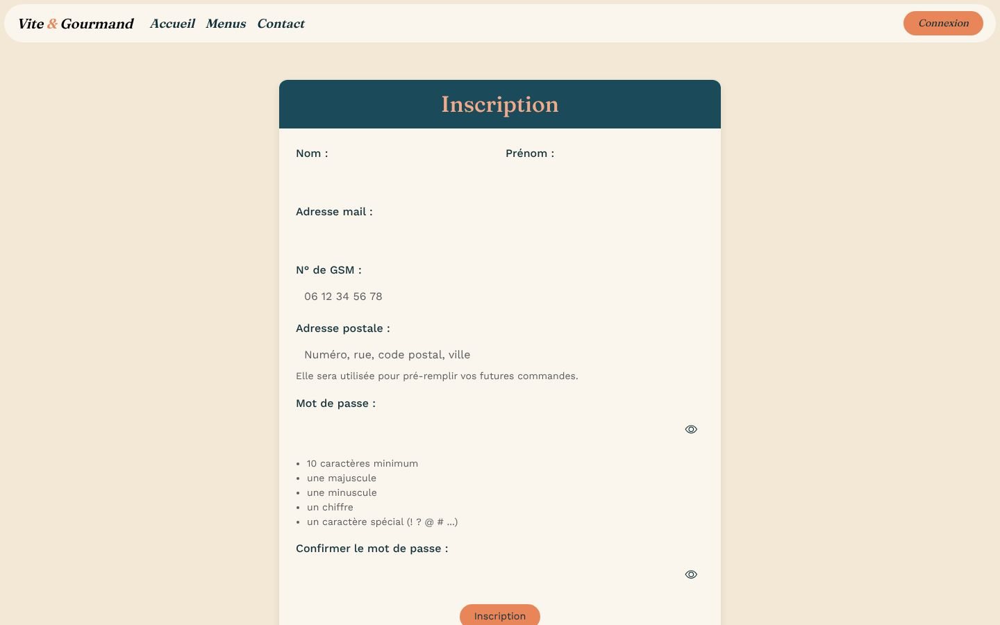<figcaption>Formulaire d'inscription.</figcaption></figure>

## Se connecter et mot de passe oublié

La connexion se fait avec l'email et le mot de passe. En cas d'oubli, **« Mot de passe oublié ? »** envoie par mail un lien de réinitialisation, valable 1 heure. Si l'email n'a pas encore été confirmé, la page propose de renvoyer le lien de confirmation.

<figure>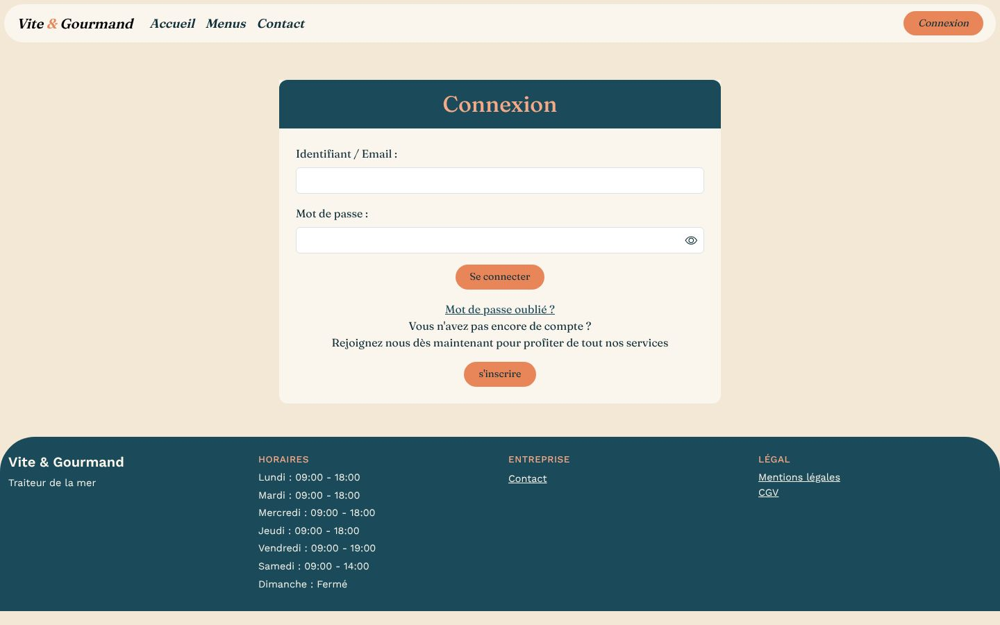<figcaption>Page de connexion.</figcaption></figure>

## Contacter l'entreprise

La page **Contact** demande un email (pour la réponse), un titre et un message. La demande est envoyée par mail à l'entreprise.

<figure>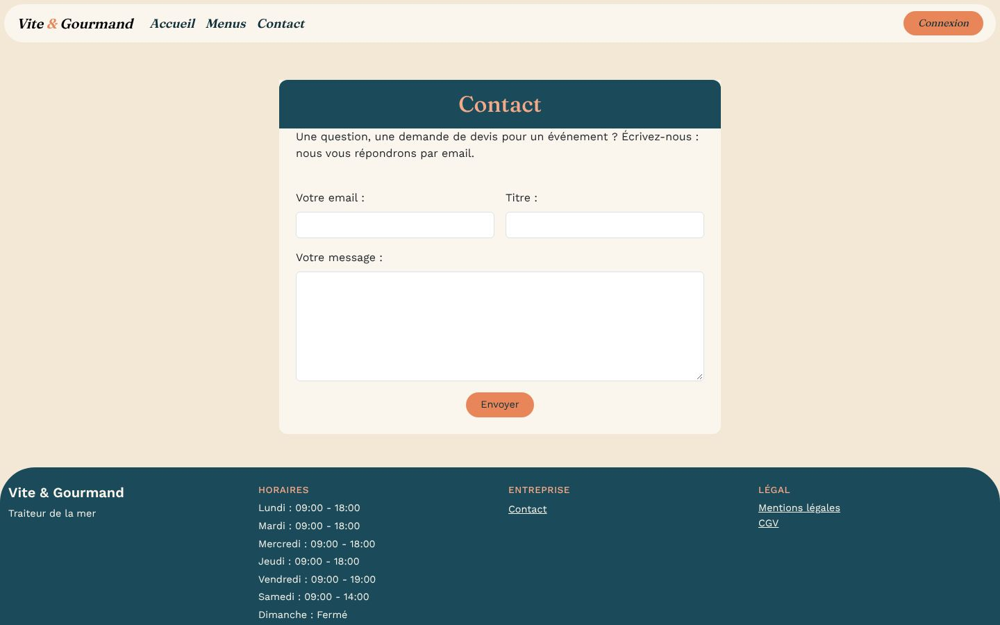<figcaption>Formulaire de contact.</figcaption></figure>

# 4. Parcours du client

Connectez-vous avec un compte client. Le menu affiche alors **Profil** et **Déconnexion**.

## Commander un menu

Depuis la liste des menus ou la fiche détaillée, **Commander** ouvre le formulaire, avec le menu déjà choisi :

1. **Vos informations** : nom, prénom, email et GSM sont repris du compte.
2. **La prestation** : date, heure de livraison souhaitée et adresse. L'adresse du compte est proposée, mais vous pouvez livrer ailleurs.
3. **Nombre de personnes** : au moins le minimum du menu.
4. **Détail du prix**, mis à jour à chaque changement :
    - prix du menu ;
    - **réduction de 10 %** dès 5 personnes de plus que le minimum ;
    - **livraison** offerte à Bordeaux, sinon 5 € + 0,59 € par kilomètre ;
    - total.
5. **Conditions du menu** : elles sont rappelées et doivent être acceptées avant de valider.

Après **Confirmer la commande**, un **mail de confirmation** est envoyé, et la commande apparaît dans votre profil.

<figure>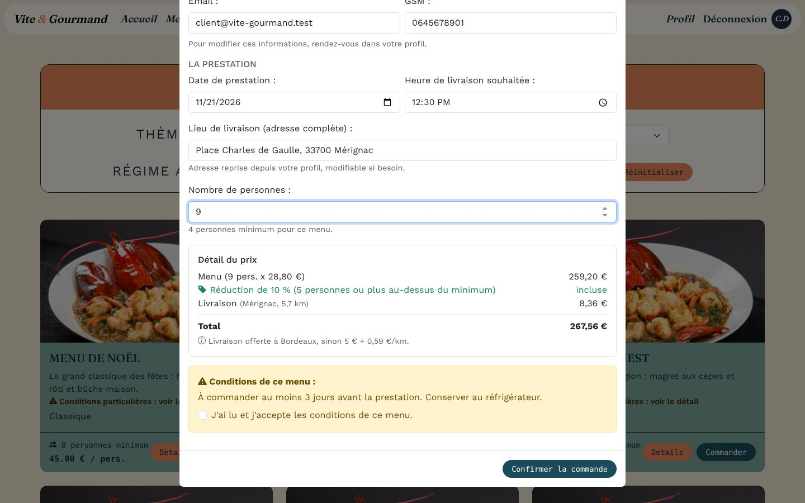<figcaption>Commande pour 9 personnes à Mérignac : réduction de 10 % et livraison à 8,36 € pour 5,7 km.</figcaption></figure>

## Mon profil

Le profil regroupe :

- **Mes informations personnelles**, modifiables avec le bouton « Modifier » ;
- **Sécurité** : changement du mot de passe ;
- **Mes commandes** ;
- **Mes avis** ;
- **Supprimer mon compte**.

<figure>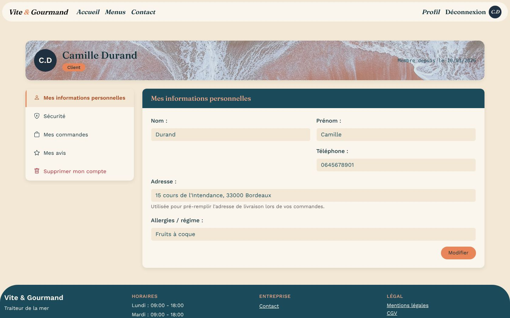<figcaption>Informations personnelles.</figcaption></figure>

## Suivre, modifier ou annuler une commande

Dans **Mes commandes**, chaque commande affiche son menu, sa date, son adresse, son prix détaillé et son **statut**.

- Tant que la commande est **« En attente »**, les boutons **Modifier** (date, heure, adresse, nombre de personnes, mais pas le menu) et **Annuler la commande** sont disponibles.
- Une fois la commande acceptée par l'équipe, ces boutons disparaissent.
- **« Suivi de la commande »** affiche alors chaque étape avec sa date et son heure.

<figure>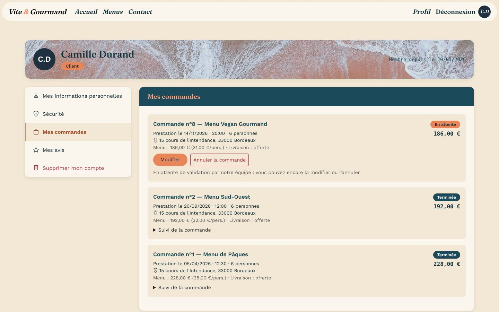<figcaption>Mes commandes : la commande en attente peut encore être modifiée ou annulée.</figcaption></figure>

<figure>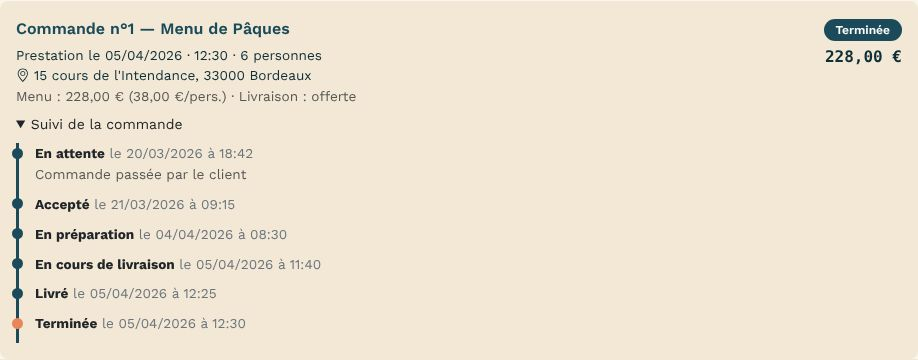<figcaption>Suivi d'une commande terminée.</figcaption></figure>

## Donner un avis

Quand une commande passe à **« Terminée »**, le client reçoit un mail l'invitant à donner son avis. Dans **Mes avis**, le bouton **Ajouter un avis** permet de choisir la commande, une **note de 1 à 5** et un commentaire. Il n'y a qu'un avis par commande. L'avis reste « En attente de validation » jusqu'à ce qu'un employé le publie.

<figure>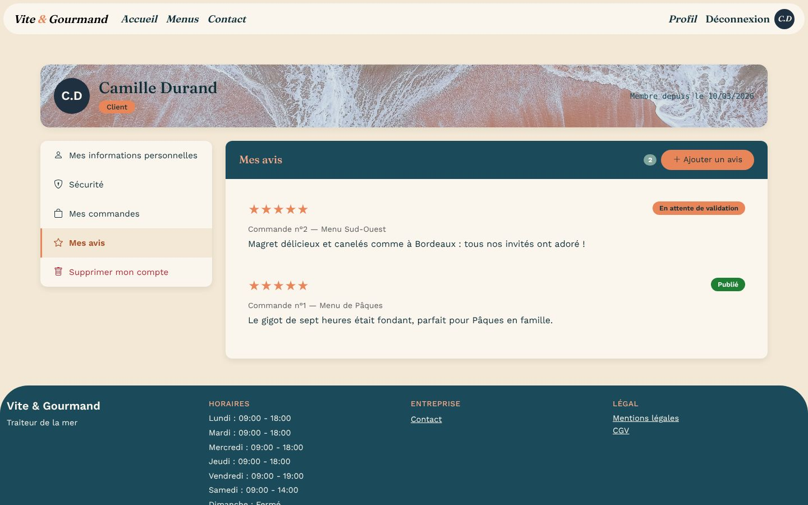<figcaption>Mes avis : un avis publié et un avis en attente de validation.</figcaption></figure>

## Supprimer son compte

Dans **Supprimer mon compte**, la suppression demande le mot de passe :

- **Sans commande**, le compte est supprimé.
- **Avec des commandes passées**, les données personnelles sont **anonymisées**, car les commandes doivent être conservées.
- La suppression est impossible tant qu'une commande est en cours.

# 5. Parcours de l'employé

Connectez-vous avec un compte employé. Le menu affiche **Tableau de bord**.

## Vue d'ensemble

Le tableau de bord résume l'activité : commandes en attente, chiffre d'affaires du mois, avis à modérer, nombre de clients et dernières commandes. Les rubriques sont à gauche.

<figure>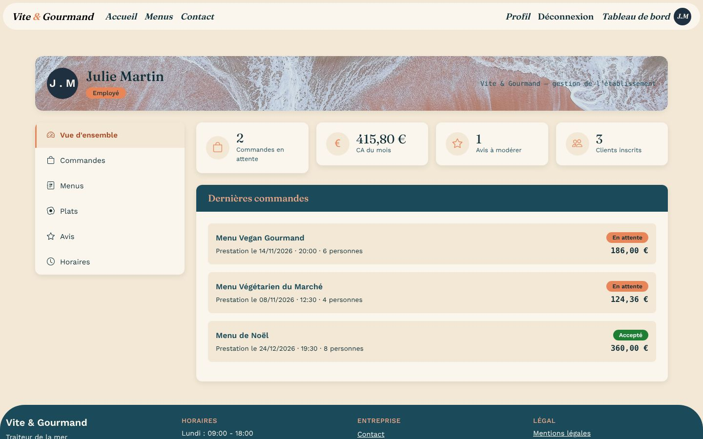<figcaption>Tableau de bord de l'employé.</figcaption></figure>

## Gérer les commandes

La rubrique **Commandes** liste toutes les commandes. Deux **filtres** aident à retrouver rapidement les commandes à traiter : par **statut**, et par **client** (nom, prénom ou email). **Gérer** ouvre le détail d'une commande.

<figure>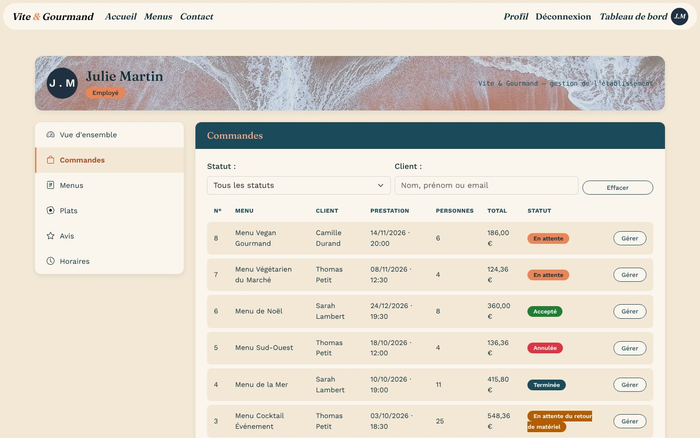<figcaption>Liste des commandes, avec les filtres par statut et par client.</figcaption></figure>

Dans le détail :

- **Mettre à jour le statut**, dans l'ordre : Accepté, En préparation, En cours de livraison, Livré, puis En attente du retour de matériel (si du matériel a été prêté) ou Terminée.
  - Le statut « En attente du retour de matériel » envoie automatiquement au client un mail : le matériel doit être rendu sous 10 jours ouvrés, sinon 600 € de frais.
  - Le statut « Terminée » envoie l'invitation à donner un avis.
- **Modifier ou annuler la commande** : il faut d'abord **contacter le client**, puis indiquer le **mode de contact** (GSM ou Email) et le **motif**. Ces informations sont enregistrées dans le suivi de la commande.

<figure>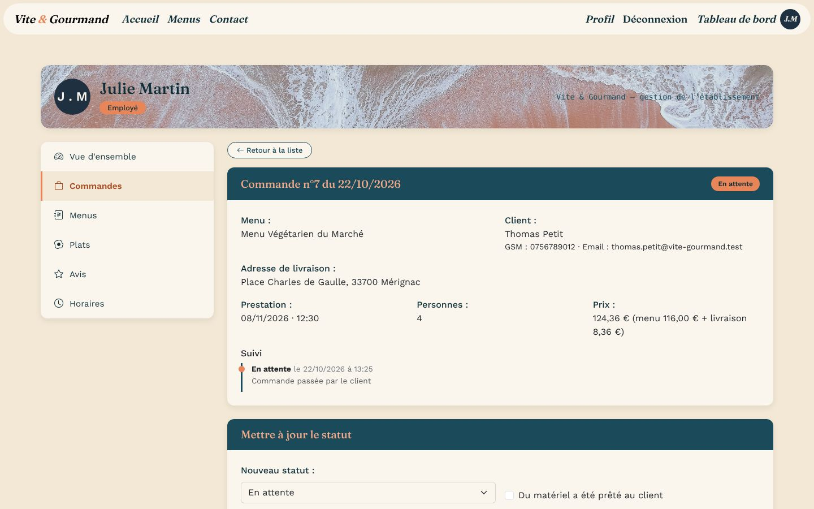<figcaption>Détail d'une commande, son suivi et le changement de statut.</figcaption></figure>

<figure>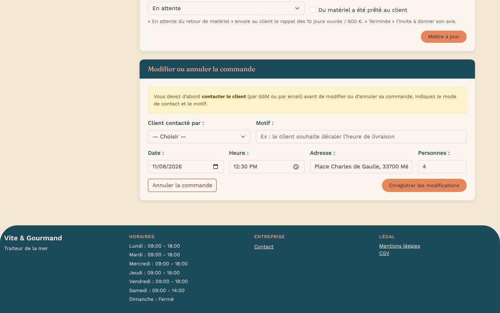<figcaption>Modification ou annulation : mode de contact et motif obligatoires.</figcaption></figure>

## Gérer les menus et les plats

- **Menus** : créer, modifier ou supprimer un menu. Pour chaque menu : titre, minimum de personnes, prix par personne, stock, photo, plats inclus, thèmes, régimes, description et conditions. Un thème ou un régime absent de la liste peut être créé directement depuis le formulaire.
- **Plats** : créer, modifier ou supprimer une entrée, un plat ou un dessert, avec sa photo, sa description et ses **allergènes**. Un même plat peut figurer dans plusieurs menus.

<figure>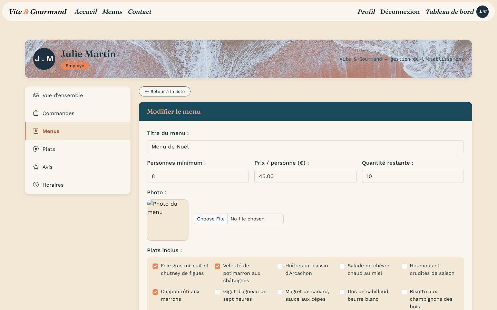<figcaption>Modification d'un menu.</figcaption></figure>

## Modérer les avis

La rubrique **Avis** liste les avis reçus. **Publier** les rend visibles sur l'accueil, **Refuser** les écarte.

<figure>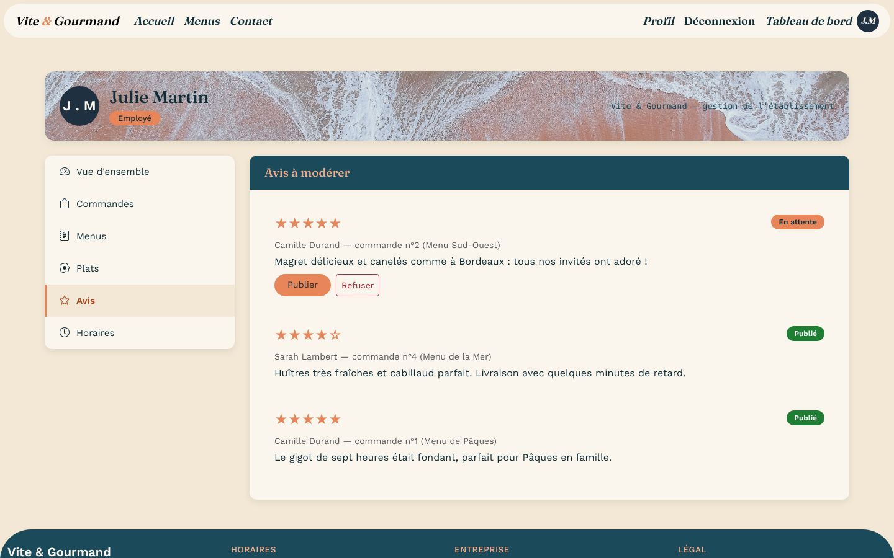<figcaption>Avis à modérer.</figcaption></figure>

## Gérer les horaires

La rubrique **Horaires** permet d'ajouter, modifier ou supprimer l'horaire de chaque jour. Un jour sans horaire s'affiche « Fermé » dans le pied de page.

<figure>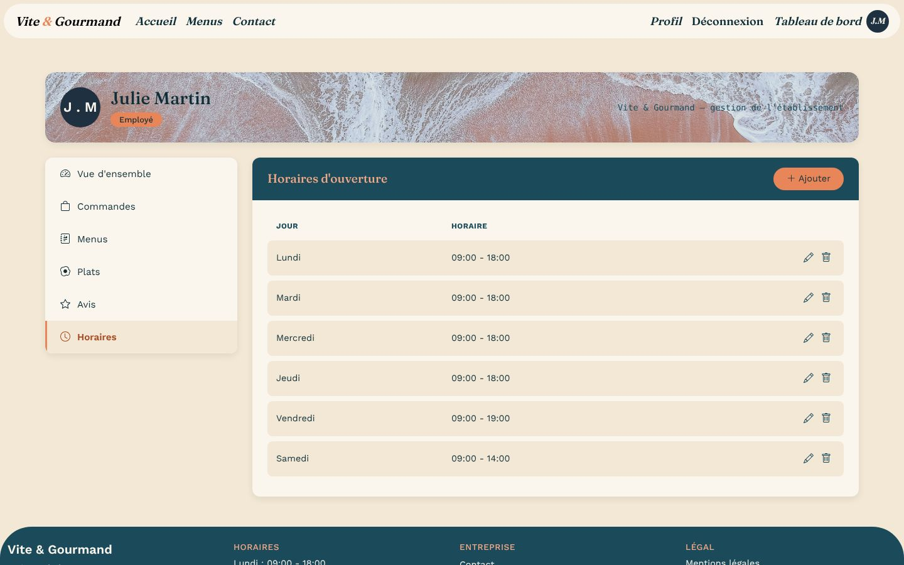<figcaption>Horaires d'ouverture.</figcaption></figure>

# 6. Parcours de l'administrateur

L'administrateur (José) peut faire **tout ce que fait un employé**, et dispose en plus des rubriques **Statistiques** et **Utilisateurs**. Il n'est pas possible de créer un autre compte administrateur depuis l'application.

<figure>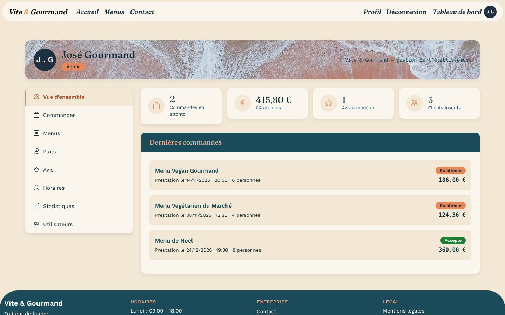<figcaption>Tableau de bord de l'administrateur.</figcaption></figure>

## Statistiques

Les statistiques sont calculées à partir de la **base MongoDB** :

- un **graphique** compare le nombre de commandes par menu ;
- le **chiffre d'affaires** est donné au total et par menu, avec des filtres par menu et par période (du… au…). Les commandes annulées ne sont pas comptées.

<figure>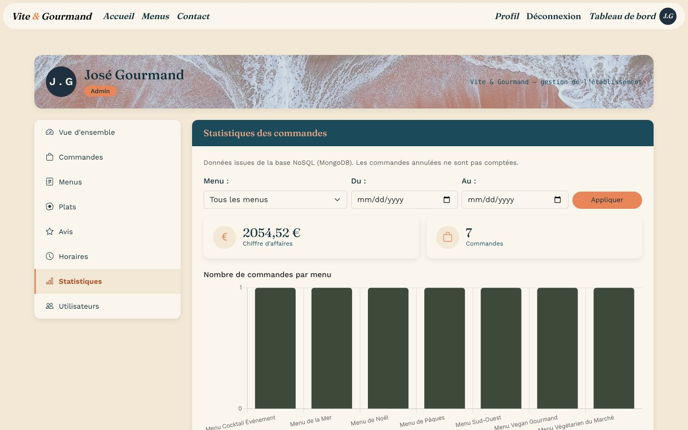<figcaption>Statistiques des commandes.</figcaption></figure>

## Créer et désactiver des comptes employés

Dans **Utilisateurs**, le formulaire **Créer un compte employé** demande le prénom, le nom, l'email (qui sert d'identifiant) et un mot de passe. L'employé reçoit un mail l'informant de la création de son compte. Le mot de passe n'y figure pas : l'administrateur le lui communique lui-même.

La liste **Tous les comptes** permet d'ouvrir chaque compte pour :

- modifier ses informations et son rôle (Client ou Employé) ;
- le **désactiver**, par exemple lors du départ d'un employé : la connexion est alors refusée et sa session en cours est coupée ;
- le réactiver ou le supprimer.

<figure>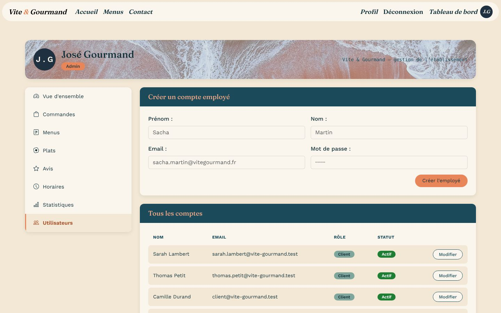<figcaption>Création d'un compte employé et liste des comptes.</figcaption></figure>

<figure>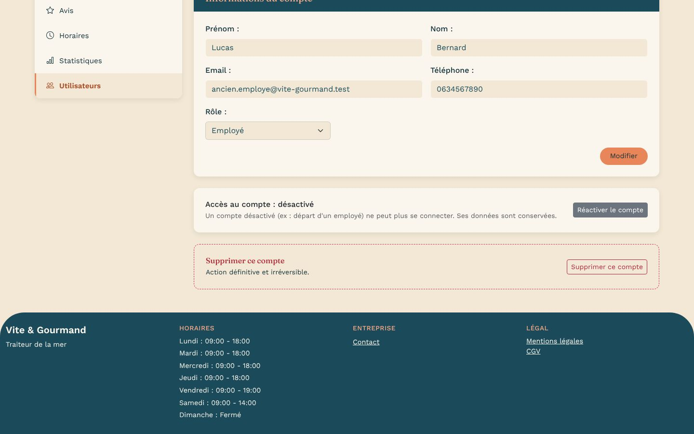<figcaption>Fiche d'un employé désactivé, avec le bouton pour le réactiver.</figcaption></figure>
